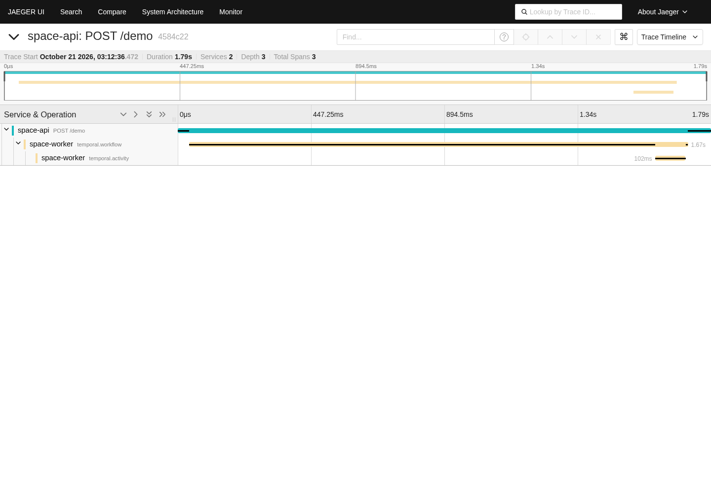

# Temporal OTLP tracing evidence

Source commit: `4c493cc` on `theTemple10/spaceapp`, branch `feat/61-temporal-otlp`.
Base: `adb96ac77531649bd335078aacaa0318ce1d20a2`.
Environment: isolated Linux development container, Node v22.23.3, locked dependencies.

## Executed validation

- `npm run check`: passed.
- `npm run build`: passed.
- `npm run hygiene:preflight`: passed, including another pre-commit check on Windows.
- `git diff --check`: passed.
- `npm test`: exited 1. The full suite is not green in this environment.

| Workspace | Full-suite result |
| --- | --- |
| Contracts | 416 passed |
| Runtime | 208 passed, including the two exporter regression tests |
| API | 3,019 passed, 15 failed, 16 skipped; one additional suite failed during setup |
| Web | 3,311 passed, 1 failed |
| Worker | 243 passed, 1 failed |

All ten new real-Temporal integration tests passed in the full suite: nine tracing/replay/collector tests and one production-workflow test across three workers. Other workspace suites completed successfully.

## Baseline comparison

The failing API files were rerun with one worker in a separate checkout of the unchanged base:

```sh
cd apps/api
npx vitest run --maxWorkers=1 \
  tests/nous-attachments.test.ts tests/browser-sessions.test.ts \
  tests/codex-home-public-install.test.ts tests/codex-parity-probe-cache.test.ts \
  tests/codex-rollout-reader.test.ts tests/databases-service.test.ts \
  tests/files-search-routes.test.ts src/__tests__/files-search-errors.test.ts \
  src/__tests__/toolbar-model-stats.test.ts
```

All 15 failing assertions and the failed setup suite reproduced. The baseline had one additional failing assertion (16 failed, 113 passed, one skipped). Causes included missing `sqlite3`, ripgrep, ffmpeg and the expected Chrome binary; Python 3.11 rejecting an existing f-string; and running a deliberately unreadable-file fixture as root.

The worker failure also reproduced on the base with `npx vitest run --maxWorkers=1 tests/codex-cli-completion.test.ts`: `spawn sqlite3 ENOENT` (one failed, 12 passed).

The web failure was in `clipboard-dock.test.tsx`. Running `npx vitest run --maxWorkers=1 tests/clipboard-dock.test.tsx` passed all 14 tests on both the unchanged base and final branch. Its source was not modified. This is an intermittent full-suite failure, not evidence that the full suite passed.

## Collector proof



The screenshot is a real browser capture of Jaeger all-in-one 1.68.0. `jaeger.json` is the raw trace query response; `demo.json` contains the trace ID, exact parent IDs and exporter counters (one API span, two worker spans, zero failures or drops).

`demo.mjs` runs Fastify, the production Temporal Codex starter/workflow and a synthetic activity using a disposable Temporal test server. It verifies the exported parent IDs against Jaeger's response. To reproduce, copy it to the checkout's ignored `scratch/demo.mjs`, start a loopback Jaeger collector on 4318 with query API on 16686, then run `node --import tsx scratch/demo.mjs` after installing dependencies and building internal packages.

This proves the tracing path with synthetic work. It does not prove authenticated provider behavior, deployment database behavior, production-history replay or performance. Spans are best effort and workflow spans are emitted at completion. Host-process spans remain outside the issue's scope.
